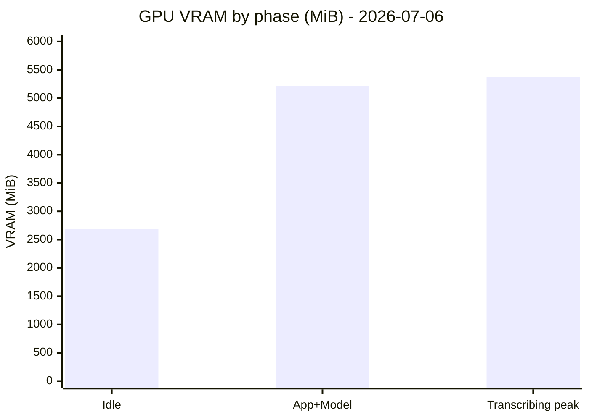
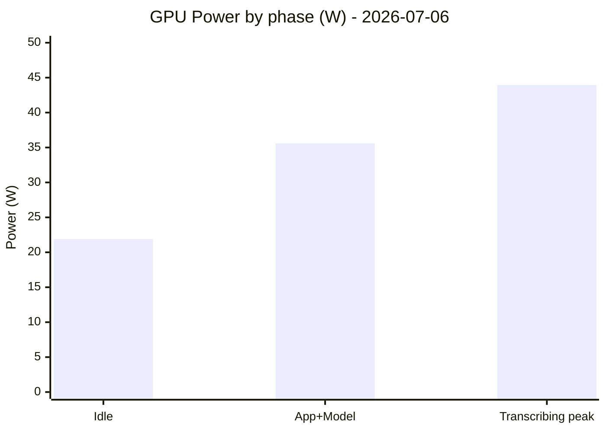

# Echophrase Benchmarks

## Why this matters

Echophrase is built on **Tauri + Rust** instead of Electron - and it shows.
The extracted app itself is just **34.2MB on Windows** - small enough that
updates ship and install fast instead of re-downloading a bloated Electron
runtime every release. On an RTX 5080, it idles at ~35.6W GPU / ~226MB RAM
with NVIDIA Parakeet-TDT 0.6B loaded and ready, and a single transcription only costs a
marginal **+7.8W and +4.3MB RAM** - barely a blip. Repeated back-to-back
transcriptions hold flat, not climbing (confirmed via a 5-utterance stress
check), so this is a sustainable, always-ready footprint rather than
something that degrades over a session.

For context: no competing dictation app (Wispr Flow, superwhisper, MacWhisper,
VoiceInk, Handy, Ratschn) publishes a comparable GPU-watt or per-utterance
VRAM benchmark, so this is more rigorous data than exists anywhere else in
this category. What *is* independently documented:
- **Idle RAM:** Wispr Flow (the closest bloated competitor - Electron-adjacent
  stack, though its exact framework isn't publicly confirmed) reportedly idles
  at ~800MB RAM vs. Echophrase's ~226MB.
- **Install size:** any Electron-based app inherits a ~150-200MB runtime floor
  (bundled Chromium + Node + V8) before a line of app code is added, with real
  apps commonly landing at 300-500MB installed. Echophrase's 34.2MB undercuts
  even that bare floor by ~4-6x, before comparing to a fully-built competitor.

That's real, verifiable data; where we don't have a like-for-like competitor
benchmark (GPU watts, per-utterance VRAM, or a confirmed/sourced Wispr Flow
install size), we say so below rather than overclaim.

**Hardware:** NVIDIA GeForce RTX 5080
**Model:** NVIDIA Parakeet-TDT 0.6B
**Tooling:** `sample-gpu.ps1` / `sample-proc.ps1` (this repo). GPU power/VRAM/util
via `nvidia-smi --query-gpu=... -lms <interval>` (one long-lived process, not
spawned per-sample); RAM/CPU via `Get-Process`. Sampler overhead is small
(one nvidia-smi process + cheap `Get-Process` reads) but not zero - treat
these as close estimates, not lab-isolated numbers. True CPU package wattage
isn't measured (Windows doesn't expose it without HWiNFO).

## TL;DR (2026-07-06)

| Phase | GPU Power | GPU VRAM | RAM | CPU |
|---|---|---|---|---|
| Idle (app closed) | ~21.9 W | 2690 MiB | - | - |
| App + model loaded (idle) | ~35.6 W | 5217 MiB | 226.6 MB | 0% |
| Transcribing one phrase (marginal peak) | +7.8 W | +31 MiB | +4.3 MB | 5% peak |

Single-utterance cost is small - a fraction of a watt-second and well under
200MB delta. See below for the full breakdown, an important memory-behavior
finding, and how this stacks up against competitors.

---

## 2026-07-06 - re-run with fixed %CPU methodology, fresh baseline

`sample-proc.ps1` was updated to compute real, comparable %CPU: delta
CPU-seconds ÷ delta wall-seconds ÷ logical core count (Task-Manager-style),
alongside the raw cumulative `cpu_seconds` counter. The 07-05 run below
predates this fix and only has cumulative seconds.

| Phase | GPU Power | GPU VRAM | GPU Util | RAM | CPU |
|---|---|---|---|---|---|
| Idle (app closed) | ~21.9 W avg | 2690 MiB | ~7.0% | n/a | n/a |
| App loaded (idle, not transcribing) | ~35.6 W avg | 5217 MiB | ~3% | 226.6 MB | 0% (2.891s cumulative, flat) |
| Transcribing - single-utterance marginal peak | +7.8 W (36.1→43.94 W) | +31 MiB (5343→5374 MiB) | up to 4% | +4.3 MB (386.4→390.7 MB) | 5% peak (+0.265s cumulative over ~7s window) |
| Transcribing - cumulative drift, first 2 utterances after launch | 35.6→43.94 W | 5217→5374 MiB (+157 MiB) | up to 5% | 226.6→390.7 MB (+164 MB) | 2.891s→3.703s cumulative |

**Idle floor moved between test sessions** (35.9W/3% util on 07-05 vs.
21.9W/7% util on 07-06) with the app confirmed closed both times - almost
certainly other system activity, not Echophrase. Treat "idle" as a moving
floor, not a constant, and always capture a fresh baseline per session.

### Memory behavior: not a leak

RAM/VRAM jumped after the first couple of transcriptions (226.6→390.7 MB RAM,
5217→5374 MiB VRAM) and didn't fall back down - initially looked leak-like.
**Follow-up test:** ran several more utterances back-to-back with no restart.

| | RAM | GPU VRAM |
|---|---|---|
| Before the batch | 385.31 MB | ~5343 MiB |
| After ~5 more utterances | 385.48 MB | 5332 MiB |

Flat. RAM/VRAM plateau after the first couple of calls and stay there
regardless of how many more phrases follow - this is a one-time warm-up
buffer/cache, not a per-call leak. Good result.

**Caveat (2026-11-14): this only holds for short utterances.** A real Windows
install hit ~4.5 GB after a single 300 s recording (max_recording_time = 300),
then sat idle in the tray. The whole buffer goes to one `transcribe_samples` call,
and encoder activations grow superlinearly with length; ORT keeps the peak.
Repro (Linux, CPU EP, same parakeet-rs 0.3.4 / ort rc.12, looped audio, peak
RSS minus the 2.2 GB weights that DirectML keeps on the GPU instead):

| Audio length | Peak RSS delta over loaded model |
|---|---|
| 10 s | +0.3 GB |
| 60 s | +0.6 GB |
| 120 s | +0.8 GB |
| 300 s | +3.3 GB (retained after the call returns) |

Linux CPU EP is not DirectML, so treat the Windows number as "same shape",
not an exact match.

**Fix (2026-11-16): long audio is now chunked, and the model can be unloaded
after N idle minutes (opt-in setting, off by default).** Re-measured with the app's real `chunking.rs` on 293 s of
real English speech (Windows TTS, 633 known words), same machine and build:

| | Peak RSS | Time | Words matched | Accuracy vs reference |
|---|---|---|---|---|
| One 293 s call | 5423 MB | 27.1 s | 633/633 | 98.7% |
| 10 chunks of ~30 s | 2763 MB | 13.8 s | 633/633 | 98.6% |

The loaded model alone is ~2225 MB here, so the working-memory spike dropped
from about +3.2 GB to about +0.54 GB. The two transcripts differ by one token
(`9` vs `nine`). A looped Mandarin clip is useless for this check: Parakeet v3
is a European-language model and emits gibberish whose length varies per chunk.

## 2026-07-05 - original run (cumulative CPU-seconds only)

| Phase | GPU Power | GPU VRAM | GPU Util | RAM (working set) | Notes |
|---|---|---|---|---|---|
| Idle (app closed) | ~35.9 W avg | 3376 MiB | ~3% | n/a | system/GPU floor |
| App loaded (not transcribing) | ~36.3 W avg | 5988 MiB (+2612 MiB for model) | ~3% | 251.6 MB | 10s after launch |
| Transcribing (peak) | 44.16 W | 6138 MiB (+150 MiB) | up to 9% (brief) | 439.1 MB (+187 MB) | burst lasts ~2-3s |
| Model load spike (one-time) | 62.46 W | 6199 MiB | 13% | 288.09 MB | transient, during initial load |

CPU: cumulative process CPU-seconds rose ~0.43s over the ~3.5s transcription
burst (no %CPU column yet at this point - see 07-06 re-run above).

Full separated app-vs-model breakdown + charts:
[`reports/2026-07-05_1814_echophrase-benchmark.md`](reports/2026-07-05_1814_echophrase-benchmark.md)

### Raw sample logs (this repo root)
`logs_idle_gpu*.csv`, `logs_loaded_gpu*.csv`, `logs_loaded_proc*.csv`,
`logs_transcribe_gpu*.csv`, `logs_transcribe_proc*.csv`, `logs_launch_gpu.csv`,
`logs_launch_proc.csv` (versioned `_v2`/`_v3`/etc. suffixes are re-runs across
sessions, newest last).

---

## Competitor Research (2026-07-05)

Googled the top dictation/local-STT competitors for comparable benchmark data.
**No competitor in this category publishes a controlled GPU-watt or
per-utterance VRAM benchmark** - the numbers above appear more rigorous than
anything publicly available for this app class. Table below reflects what
actually surfaced near the top of Google, flagged by how solid the source is.

| App | Stack | What's published | Source |
|---|---|---|---|
| **Wispr Flow** | Cloud-based, Electron-adjacent | ~800MB RAM, ~8% idle CPU (user-reported, anecdotal) | [Spokenly comparison](https://spokenly.app/blog/wispr-flow-vs-superwhisper-vs-macwhisper) |
| **superwhisper** | Native macOS (Swift), hybrid on/off-device | No published RAM/VRAM numbers | - |
| **MacWhisper** | Native macOS | File-based, not live dictation; no resource numbers | - |
| **VoiceInk** | Native macOS (Swift), GPLv3, 4.4k+ GitHub stars | No published RAM/VRAM numbers | [GetVoibe comparison](https://www.getvoibe.com/resources/superwhisper-vs-voiceink/) |
| **Handy** | Tauri (Rust) + whisper.cpp, MIT | Marketed as lightweight vs. Electron; no hard numbers | [HN launch](https://news.ycombinator.com/item?id=45399106), [Voibe review](https://www.getvoibe.com/resources/handy-review/) |
| **Ratschn** | Rust + Tauri + CoreML | Built explicitly to avoid "heavy Electron wrappers" (dev's words, not measured) | [Show HN](https://news.ycombinator.com/item?id=47313205) |

**Electron vs. Tauri, general** (consistent across independent 2026 blog
benchmarks, not lab-controlled):
- Idle RAM: Tauri ~30-50MB vs. Electron ~120-300MB
- Bundle size: Tauri often ~25x smaller
- Sources: [Rustify](https://rustify.rs/articles/rust-tauri-vs-electron-2026), [PkgPulse](https://www.pkgpulse.com/blog/best-desktop-app-frameworks-2026), [Hopp](https://www.gethopp.app/blog/tauri-vs-electron), [Tech Insider](https://tech-insider.org/tauri-vs-electron-2026/)

**Installed disk size, dictation competitors specifically:** no dictation app
in this category has a solidly-sourced install-size figure. A ~200MB Wispr
Flow disk-size claim exists but only in aggregated review/blog content, never
Wispr's own site or GitHub - flagged low-confidence, not used below.

**Electron runtime floor** (architecture-level, applies to any Electron-based
dictation competitor including Wispr Flow, regardless of exact install size):
bundled Chromium + Node + V8 adds ~150-200MB before any app code, with real
apps commonly landing at 300-500MB installed -
[Tech Insider](https://tech-insider.org/tauri-vs-electron-2026/),
[Forasoft](https://www.forasoft.com/blog/article/electron-desktop-app-development-guide-for-business),
[Coderio](https://www.coderio.com/blog/software-development/electron-framework-complete-guide/).
For a broader (non-dictation) sanity check, real installed Electron apps run
Slack ~650MB, Discord ~360MB, VS Code ~300MB -
[codenote.net 2026 audit](https://codenote.net/en/posts/famous-electron-apps-2026-research/).
Echophrase's 34.2MB undercuts even the bare ~150-200MB Electron floor by
~4-6x, before any app code is factored in for a real competitor. (Note:
"~800MB" is Wispr Flow's reported idle *RAM*, not install size - worth not
conflating the two, confirmed via follow-up research 2026-07-06.)

**Parakeet/Whisper VRAM context** (real technical benchmarks, but server/batch
inference - not single-utterance desktop use, so not a direct comparison):
- Parakeet-TDT-0.6B fp16 on NVIDIA L4: ~5.1GB flat VRAM at batch 1-32, jumping
  to ~7.1GB at batch=64 - [E2E Networks](https://www.e2enetworks.com/blog/benchmarking-asr-models-nvidia-l4-parakeet-whisper-nemotron)
- int8-quantized Parakeet: ~2GB during inference
- Whisper large-v3 fp16: ~3GB VRAM - [GigaGPU](https://gigagpu.com/whisper-vram-requirements/)
- No GPU-wattage figures found anywhere for Parakeet or whisper.cpp - Tom's
  Hardware's [18-GPU Whisper benchmark](https://www.tomshardware.com/news/whisper-audio-transcription-gpus-benchmarked)
  measures throughput (words/min), not power.

**Takeaway:** our ~44W burst peak (+8W over idle) and small VRAM/RAM deltas
per utterance are plausible given the batch-inference VRAM footprints above,
but that's "consistent with," not "confirmed by," a like-for-like benchmark -
nobody else measures this the way we just did. The Tauri+Rust choice tracks
with the general Electron-vs-Tauri resource gap (directionally solid, but
blog-sourced rather than academic), and echoes the same "avoid heavy Electron
wrappers" reasoning other Rust/Tauri dictation devs (Handy, Ratschn) cite for
their own apps.
